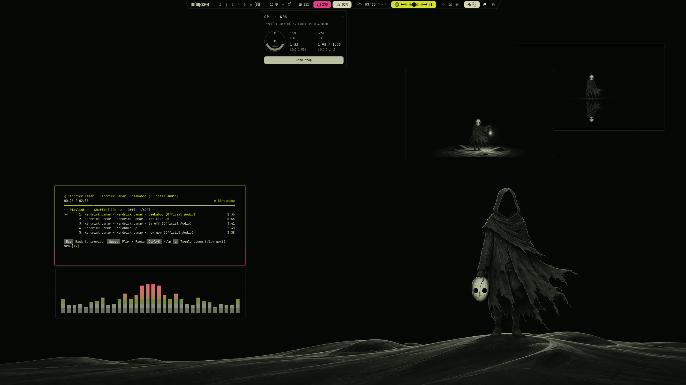

# Labra

# Installation Theme

To install this theme, simply use the omarchy-theme-install command:

```bash
omarchy-theme-install https://github.com/HANCORE-linux/omarchy-labra-theme.git
```

Omarchy skips every `.lua` in a theme installed from a repo, so this way leaves out
`gum_env.lua` and `hyprland.lua`. Clone into `~/custom-themes/labra` and link
instead to get the whole theme:

```bash
mkdir -p ~/custom-themes ~/.config/omarchy/themes &&
git clone https://github.com/HANCORE-linux/omarchy-labra-theme.git ~/custom-themes/labra &&
ln -sT ~/custom-themes/labra ~/.config/omarchy/themes/labra &&
omarchy theme set labra
```

<details>
<summary>Enable Shell Plugins</summary>

The custom menu, OSD and notification plugins are optional. The menu replaces
the built-in overlay; it does not add a bar widget. Install the plugins as real
folders so Shibumi's plugin catalog can read them.

Copy the plugins (works from Bash, Zsh and Fish):

```bash
mkdir -p ~/.config/omarchy/plugins &&
cp -a ~/.config/omarchy/themes/labra/shell-plugins/. ~/.config/omarchy/plugins/ &&
omarchy-shell shell rescanPlugins &&
echo "Plugins copied. Run the activation commands below."
```

**Then activate them:** copying alone does not enable the plugins. Each enable
command prints `Enabled labra.…` on success.

```bash
omarchy plugin enable labra.menu &&
omarchy plugin enable labra.osd &&
omarchy plugin enable labra.notifications &&
omarchy restart shell
```

After a theme update, copy the plugins again and run `omarchy restart shell`.

</details>

<details>
<summary>Remove Shell Plugins</summary>

To restore Omarchy's built-in menu, OSD and notifications:

```bash
omarchy plugin disable labra.menu && omarchy plugin remove labra.menu --yes
omarchy plugin disable labra.osd && omarchy plugin remove labra.osd --yes
omarchy plugin disable labra.notifications && omarchy plugin remove labra.notifications --yes

omarchy restart shell
```

The original files in the theme folder are kept.

</details>



#### Quickshell-Bar
[LINK](https://github.com/HANCORE-linux/Shibumi-Shell)

#### Theme-Hook-Manager
[Link](https://github.com/OldJobobo/theme-hook-plugin-manager)
